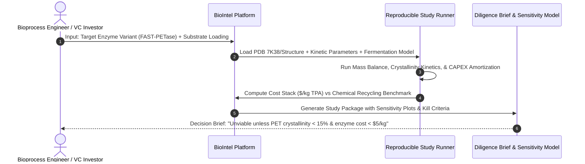

# BioIntel Phase 4: Product Wedge Assessment & Commercial Workflow Selection

**Author:** Biotechnology Commercialization Analyst & Product Strategist  
**Target:** BioIntel Initial Market Wedge Determination  
**Audit Date:** November 2026  
**Document Classification:** Strategic Product Definition & Feasibility Evaluation  

---

## 1. Head-to-Head Comparison of Candidate Research Markets

To prevent BioIntel from diluting its analytical depth across all of biotechnology, we evaluated two candidate product wedges across ten objective criteria:

- **Candidate A:** Protein Engineering and Industrial Biotechnology Commercialization (Enzyme biocatalysis, precision fermentation, synthetic metabolic pathways, biomaterials).
- **Candidate B:** Gene Editing and Therapeutic Platform Diligence (CRISPR nucleases, base editing, prime editing, in vivo LNP/AAV delivery, cell therapy).

```mermaid
quadrantChart
    title Commercial Feasibility vs Data Verifiability
    x-axis Low Data Verifiability --> High Data Verifiability
    y-axis Low Decision Directness --> High Decision Directness
    quadrant-1 Initial Product Wedge (Target)
    quadrant-2 Diligence Overhead
    quadrant-3 Speculative AI Generation
    quadrant-4 Complex Clinical Pipelines
    "Candidate A: Industrial Biotech & Enzymes": [0.85, 0.88]
    "Candidate B: Gene Editing Therapeutics": [0.62, 0.45]
    "Candidate C: Clinical Trials NLP": [0.40, 0.35]
    "Candidate D: Pure Literature Summarization": [0.30, 0.20]
```

### Detailed Evaluation Scorecard

| Evaluation Criterion | Candidate A: Industrial Biotech & Enzyme Engineering | Candidate B: Gene Editing Therapeutics Diligence | Strategic Verdict |
| :--- | :--- | :--- | :--- |
| **1. Frequency of Research Decisions** | **High.** Bioprocess teams evaluate strain, promoter, and enzyme variants on a monthly/quarterly sprint basis. | **Low to Medium.** Platform diligence decisions occur primarily during fundraising rounds ($12–$24 months) or in-licensing deals. | **Candidate A leads.** Faster customer iteration loop. |
| **2. Quality & Accessibility of Public Data** | **High.** Detailed kinetic parameters ($k_{cat}, K_M$), titers ($g/L$), yields ($Y_{p/s}$), and PDB coordinates are publicly published and standardized. | **Medium.** Critical in vivo biodistribution, toxicology, and proprietary off-target sequencing data are closely guarded trade secrets. | **Candidate A leads.** Superior public data availability. |
| **3. Experimental Comparability** | **High.** Well-defined thermodynamic ($T_m$) and mass-balance metrics (titer, productivity, yield) allow direct quantitative comparison. | **Low to Moderate.** Editing outcomes vary drastically with guide design, cell line, transfection reagent, and chromatin loci, making cross-lab comparison noisy. | **Candidate A leads.** Comparability rules are mathematically clean. |
| **4. Commercialization Model Availability** | **High & Deterministic.** Unit economics are governed by physical mass balance, CAPEX amortization, and feedstock consumption ($/kg). | **Complex & Probabilistic.** Commercial value depends on clinical trial probabilities of success (POS), pricing/reimbursement, and patent litigation. | **Candidate A leads.** Techno-economic models are verifiable. |
| **5. Difficulty of Scientific Interpretation** | **Moderate.** Chemical engineering and biochemical kinetics follow established physical laws. | **Extreme.** Immune response, genotoxicity, chromosomal translocations, and deep tissue delivery involve high biological unpredictability. | **Candidate A leads.** Lower risk of catastrophic AI misinterpretation. |
| **6. Competitor Landscape** | **Fragmented.** Few structured AI tools combine PDB structure parsing with bioreactor techno-economics. | **Crowded.** Numerous pharma intelligence databases (EvaluatePharma, BioCentury, PitchBook, Cortellis) and specialized therapeutic consultancies. | **Candidate A leads.** Differentiated competitive space. |
| **7. Likely User Persona** | Bioprocess Development Director, Industrial Biotech VC Investor, Fermentation Project Manager. | Therapeutic Venture Capital Partner, Corporate BD / M&A Lead, Translational Geneticist. | Both personas have budget; Candidate A users need daily quantitative tools. |
| **8. Trust Requirements** | **Verifiable.** User can audit the mass balance spreadsheet and enzyme kinetic plots directly. | **Reputational.** Erroneous gene editing diligence can result in a failed $50M clinical program; trust barriers are immense. | **Candidate A leads.** Errors in enzyme models are easily caught by users. |
| **9. Maintenance Complexity** | **Low to Medium.** Core physics (stoichiometry, heat transfer, kinetics) do not change over time. | **High.** Requires continuous tracking of complex patent lawsuits, clinical trial amendments, and FDA guidance shifts. | **Candidate A leads.** Lower operational maintenance. |
| **10. Potential for Distinctive Insights** | **High.** Revealing that an enzyme with "5x higher in vitro activity" fails to improve process economics due to substrate crystallinity or cooling limits is an immediate, distinctive insight. | **Moderate.** Most gene editing platform limitations (AAV packaging ceiling, MMR antagonism) are already widely known to specialist reviewers. | **Candidate A leads.** High distinctive ROI. |

---

## 2. Selection of the Initial Product Wedge

**Selected Wedge: Candidate A — Protein Engineering and Industrial Biotechnology Commercialization.**

### Strategic Rationale
Industrial biotechnology offers an ideal intersection for BioIntel:
1. The scientific ground truth is governed by **rigorous biophysical laws** (thermodynamics, enzyme kinetics, and mass-transfer conservation) that BioIntel’s deterministic Python modules compute with mathematical exactness.
2. The gap between **laboratory enzyme activity** (microgram-scale in microplates) and **industrial economics** (metric tons in 50,000 L vessels) is the #1 point of capital destruction in the synthetic biology sector.
3. BioIntel creates immense value by acting as a skeptical filter that prevents investors and engineers from funding enzymes that cannot operate under commercial process constraints.

---

## 3. Concrete User Decision Workflow



### 1. User Inputs
The user provides:
- Target enzyme or microbial host identifier (e.g. `FAST-PETase` or `LCC-ICCG`).
- Literature source or experimental observation ID.
- Target process parameters (or defaults): Substrate loading ($g/L$), operating temperature ($°C$), annual plant output target ($MT/yr$).

### 2. BioIntel Processing
BioIntel executes:
1. **Structure & Stability Check:** Parses PDB coordinates, extracts melting temperature ($T_m$), and verifies that $T_{opt} \ge T_g$ of target substrate.
2. **Kinetic & Expression Reality Check:** Calculates enzyme requirement ($mg\text{ enzyme} / g\text{ substrate}$) and enzyme production burden ($g\text{ enzyme}/L$ broth).
3. **Mass-Balance & Cost Decomposition:** Computes feedstock consumption, utility load, downstream processing (DSP) recovery losses, and unamortized CAPEX.
4. **Adversarial Incomparability Check:** Flags whether literature experiments were conducted on amorphous plastic rather than commercial crystalline post-consumer waste.

### 3. User Decision Output
BioIntel delivers a **Reproducible Study Package** with:
- **Direct Decision Verdict:** Clear go/no-go recommendation for pilot scaling.
- **Differentiating Metrics:** Exact threshold parameters required to beat chemical recycling.
- **Falsification Criteria:** Specific bench tests that would disprove the investment thesis.
- **Interactive Sensitivity Matrix:** 2D heatmap showing break-even unit cost across substrate price and enzyme loading.
