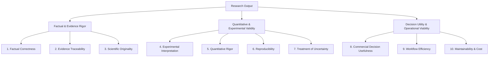
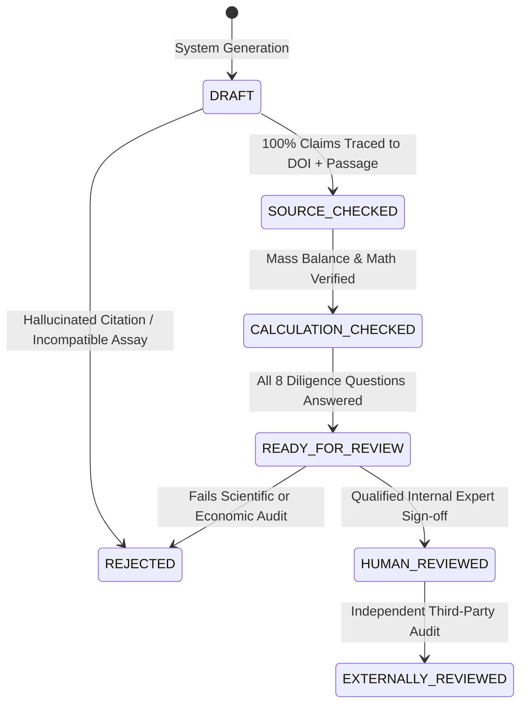

# BioIntel Phase 4: Scientific Quality Audit & Hard Research Quality Gates

**Author:** Biotechnology Research Architect & Diligence Quality Lead  
**Audit Target:** BioIntel Platform Research Generation System  
**Audit Date:** November 2026  
**Document Classification:** Scientific Quality Standards & Governance Framework  

---

## 1. The Ten Dimensions of Biotechnology Research Quality

BioIntel evaluates all research outputs across ten distinct, non-fungible dimensions. To prevent superficial aggregation, these dimensions are **never collapsed into a single scalar score**.

### Dimension Definitions & Evaluation Rubrics

| # | Dimension | Definition & Operational Test | Failure Mode (Automatic Demotion) |
| :- | :--- | :--- | :--- |
| **1** | **Factual Correctness** | Every biological entity, sequence, catalytic residue, and historical event matches primary reference databases (NCBI, UniProt, wwPDB). | Misidentifying a catalytic residue, confusing species orthologs, or misstating enzyme classification. |
| **2** | **Evidence Traceability** | Every numerical claim or conclusion links directly to an authoritative DOI/PMID, table/figure location, and verifiable quoted passage. | Citing a paper for a number that does not appear in that paper; orphan claims. |
| **3** | **Experimental Interpretation** | Distinguishing biological from technical replicates; recognizing confounding factors, cell line artifact limitations, and assay-specific biases. | Treating technical triplicates from one flask as independent biological trials ($n=3$); ignoring cell-cycle dependence. |
| **4** | **Quantitative Rigor** | Physical conservation laws (mass balance, stoichiometry, thermodynamic equilibrium) are strictly obeyed. Equations use explicit units. | Reporting volumetric productivity exceeding maximum specific growth rate; negative mass balances; missing unit conversions. |
| **5** | **Reproducibility** | A third-party engineer can re-run the study calculations and regenerate identical numbers and figures from preserved inputs and scripts. | Non-deterministic scripts; unversioned input datasets; missing calculation parameters. |
| **6** | **Treatment of Uncertainty** | Expressing experimental errors with standard deviation, 95% confidence intervals, and explicit sensitivity ranges rather than point values. | Stating a single break-even cost ($24.64/kg) without reporting variance across feedstock price ($0.25–$0.80/kg) and titer. |
| **7** | **Scientific Originality** | Clearly separating retrieved literature facts from novel synthesis, derived techno-economic calculations, and new testable hypotheses. | Claiming that summarizing three papers is an "original scientific breakthrough." |
| **8** | **Commercial Decision Usefulness** | Explicitly addressing a real capital allocation, partnership, or project decision with clear trade-offs, kill criteria, and sensitivity analysis. | Writing 30 pages of background biology that never reaches an actionable decision or trade-off recommendation. |
| **9** | **Workflow Efficiency** | Delivering research in less time, with higher fidelity and lower analyst fatigue than manually searching PubMed and Google Sheets. | Requiring more human debugging and fact-checking than conducting manual literature search from scratch. |
| **10** | **Maintainability & Operating Cost** | Capable of executing locally on open-source toolchains (Python 3.11, SQLite) with near-zero marginal cost per query (< $0.01). | Requiring expensive hosted vector databases, paid proprietary LLM tokens, or fragile distributed microservices. |

---

## 2. Hard Quality Gates & Review Status Lifecycle

To prevent AI-generated "research slop" from infiltrating decision-making, BioIntel enforces strict, auditable review status transitions.

### Hard Quality Gates (Automatic Rejection Criteria)

A research report or study package **CANNOT** be promoted to `READY_FOR_REVIEW` or higher if any of the following conditions exist:

1. **Unsubstantiated Critical Claim:** Any decision-critical factual claim lacks a primary source citation.
2. **False Citation Attribution:** An attached citation does not contain or directly support the referenced finding.
3. **Assay Boundary Violation:** Compares measurements across incompatible assays (e.g., T7E1 mismatch cleavage vs. targeted NGS deep sequencing; in vitro cell-free translation vs. in vivo primary tissue).
4. **Non-Reproducible Calculation:** Mathematical formulas cannot be executed deterministically from preserved scripts and parameters.
5. **Prediction/Experiment Conflation:** An in silico prediction (e.g., AlphaFold pLDDT, molecular dynamics trajectory) is presented as experimentally solved structural confirmation.
6. **Hidden Assumptions:** A commercial or economic conclusion relies on missing inputs presented as established facts (e.g., assuming 95% downstream recovery without pilot data).
7. **Unsupported Regulatory / Clinical Claims:** Conflating preclinical proof-of-concept with FDA phase 1 readiness or commercial clearance.
8. **Automated Approval Pretense:** Any unreviewed automated output claiming to be "PhD-grade", "investment-grade", or "peer-reviewed."

### Allowed Status Transitions

- **`DRAFT`**: Automated extraction or synthesis generated by BioIntel. Contains unverified citations and preliminary math.
- **`SOURCE_CHECKED`**: 100% of claims verified against primary sources, with character-level or paragraph-level quotation excerpts and valid DOIs.
- **`CALCULATION_CHECKED`**: All quantitative models, mass balances, and unit conversions independently executed and verified.
- **`READY_FOR_REVIEW`**: Report meets all structural requirements, answers the 8 diligence questions, and is packaged for expert human inspection.
- **`HUMAN_REVIEWED`**: A named, qualified scientist or investment analyst has reviewed, edited, and approved the study.
- **`EXTERNALLY_REVIEWED`**: An independent third-party auditor has validated the findings.
- **`REJECTED`**: Report failed one or more hard gates and has been archived with documented failure reasons.

> [!CAUTION]
> **Strict Governance Enforcement:** Only actual documented human actions may assign `HUMAN_REVIEWED` or `EXTERNALLY_REVIEWED`. The BioIntel software agent is barred from self-assigning these statuses under any circumstance.

---

## 3. Decision Usefulness Framework

Any research memorandum, card, or study package produced by BioIntel must answer the following eight core diligence questions. If a document fails to answer these questions, it is classified as **Descriptive Background**, not **Analytical Research**.

| Question | Analytical Requirement | Example: Engineered Enzyme Biomanufacturing |
| :--- | :--- | :--- |
| **1. Who is the intended user?** | Explicit persona and operational role. | Bioprocess Development Director / Industrial Biotech VC Partner. |
| **2. What decision are they making?** | Specific capital, engineering, or partnership action. | Allocate $1.5M to scale an engineered PETase variant from shake flask to 1,000 L pilot bioreactor. |
| **3. What alternatives are available?** | Existing benchmarks and competing approaches. | Alternative 1: Wild-type *I. sakaiensis* PETase. Alternative 2: Chemical glycolysis / methanolysis. Alternative 3: Landfill disposal. |
| **4. Which data actually differentiate them?** | The exact biophysical or economic metrics that decide the trade-off. | Operating temperature ($T_m \ge 65\text{ °C}$ to reach PET glass transition $T_g$) and volumetric productivity (g terephthalic acid / L / h). |
| **5. What conclusion is supported?** | Evidence-grounded recommendation. | The engineered variant is superior to wild-type enzymatically, but economically unviable unless enzyme production cost is $< \$5.00/kg$ and PET crystallinity is $< 15\%$. |
| **6. Which assumptions can reverse it?** | Key parameter sensitivities and vulnerabilities. | If substrate pre-treatment (micronization/amorphization) costs exceed $\$0.35/kg$, chemical recycling remains cheaper regardless of enzyme activity. |
| **7. What evidence would falsify it?** | Explicit kill criteria and falsification thresholds. | A pilot batch demonstrating enzyme inactivation by terephthalic acid product inhibition at concentrations $> 20\text{ g/L}$. |
| **8. What should the user investigate next?** | Immediate high-value diligence tests. | Measure enzyme half-life ($t_{1/2}$) under continuous stirred-tank reactor conditions at $65\text{ °C}$ in the presence of $30\text{ g/L}$ product. |
