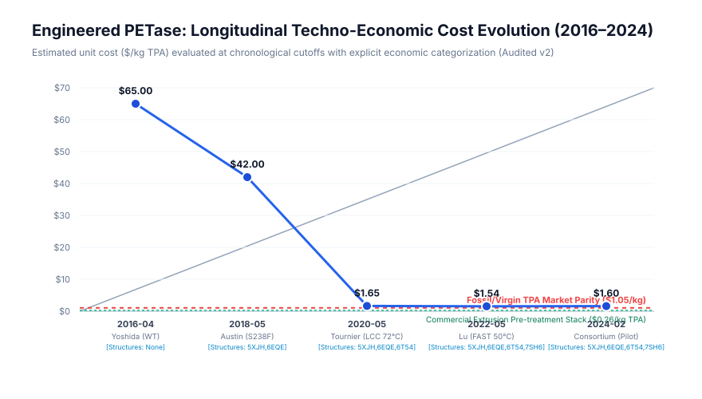

# Historical Scientific Evidence Timeline: Engineered PET-Degrading Enzymes (2016–2024)

This timeline documents the empirical evolution of biocatalytic polyester depolymerization across five chronological cutoffs. Each snapshot reflects **strictly what was knowable on that calendar date**, preventing retrospective bias.

---

## Snapshot 1 (April 2016): Initial Discovery & Wild-Type IsPETase
**As-Of Date Cutoff:** `2016-04-01` | **Snapshot Hash:** `d2de1347520d6629`

### Contemporaneous Literature (1 records)
- **2016-03-10**: Yoshida et al., A bacterium that degrades and assimilates poly(ethylene terephthalate), Science 351(6278):1196-1199 (2016) ([DOI](https://doi.org/10.1126/science.aad6359))

### Demonstrated Capabilities
- [2016-03-10] Wild-type IsPETase: 0.13 mg/cm²/day mass loss at 30 °C; 60 mg film fully degraded after 6 weeks (Substrate: 1.9% crystallinity)

### Established Physical & Engineering Boundaries
- Strictly mesophilic enzyme; irreversible thermal denaturation above 40 °C (Tm ~ 48 °C).
- Completely inactive against commercial bottle-grade crystalline PET (30-35% crystallinity).
- Enzyme secretion titer from native host is negligible; requires recombinant E. coli expression.

### Commercial Feasibility Assessment
- **Readiness Stage:** `Academic Discovery / Early Research`
- **Estimated TPA Production Cost:** **$65.00 / kg** (Target market parity ratio: **52.0x**)
- **Commercial Verdict:** ECONOMICALLY UNVIABLE: Reaction requires 6 weeks; zero activity on commercial post-consumer plastic.

### Unresolved Uncertainties at This Cutoff
- *Is the enzyme mechanism distinct from legacy fungal cutinases (e.g. Thermobifida fusca)?*
- *Can active site mutations overcome the severe steric barrier of crystalline PET chains?*
- *Can thermal stability be increased to operate near the PET glass transition temperature (Tg ~ 65-70 °C)?*

---

## Snapshot 2 (May 2018): Crystallographic Structure & Initial Active Site Engineering
**As-Of Date Cutoff:** `2018-05-01` | **Snapshot Hash:** `6d3f656a5d983a71`

### Contemporaneous Literature (2 records)
- **2016-03-10**: Yoshida et al., A bacterium that degrades and assimilates poly(ethylene terephthalate), Science 351(6278):1196-1199 (2016) ([DOI](https://doi.org/10.1126/science.aad6359))
- **2018-04-17**: Austin et al., Characterization and engineering of a plastic-degrading aromatic polyesterase, PNAS 115(19):E4350-E4357 (2018) ([DOI](https://doi.org/10.1073/pnas.1718804115))

### Demonstrated Capabilities
- [2016-03-10] Wild-type IsPETase: 0.13 mg/cm²/day mass loss at 30 °C; 60 mg film fully degraded after 6 weeks (Substrate: 1.9% crystallinity)
- [2018-04-17] IsPETase double mutant (S238F/W159H): ~20% improvement in amorphous PET degradation rate over wild-type; active site cleft narrowed (Substrate: 1.9% crystallinity)

### Established Physical & Engineering Boundaries
- Strictly mesophilic enzyme; irreversible thermal denaturation above 40 °C (Tm ~ 48 °C).
- Completely inactive against commercial bottle-grade crystalline PET (30-35% crystallinity).
- Enzyme secretion titer from native host is negligible; requires recombinant E. coli expression.
- Engineering focused on active-site pocket did not improve melting temperature (Tm ~ 46.5 °C).
- Remains completely incapable of hydrolyzing biaxially oriented bottle PET without prior thermal destruction.
- Modest ~1.2-fold improvement is insufficient to alter batch bioprocess kinetics.

### Commercial Feasibility Assessment
- **Readiness Stage:** `Lead Optimization / Protein Engineering`
- **Estimated TPA Production Cost:** **$42.00 / kg** (Target market parity ratio: **33.6x**)
- **Commercial Verdict:** COMMERCIALLY UNFEASIBLE: Establishes structural basis, but catalytic velocity at 30 °C remains orders of magnitude too slow for industrial recovery.

### Unresolved Uncertainties at This Cutoff
- *Does narrow active-site cleft restrict bulky synthetic polyester chains from entering?*
- *Why do mesophilic IsPETase variants lose all activity within 24 hours at 37 °C?*
- *Is IsPETase intrinsically the wrong enzyme chassis compared to thermophilic actinomycete cutinases?*

---

## Snapshot 3 (May 2020): Thermophilic Breakthrough Operating Near PET Glass Transition
**As-Of Date Cutoff:** `2020-05-01` | **Snapshot Hash:** `c204a3c865634b70`

### Contemporaneous Literature (3 records)
- **2016-03-10**: Yoshida et al., A bacterium that degrades and assimilates poly(ethylene terephthalate), Science 351(6278):1196-1199 (2016) ([DOI](https://doi.org/10.1126/science.aad6359))
- **2018-04-17**: Austin et al., Characterization and engineering of a plastic-degrading aromatic polyesterase, PNAS 115(19):E4350-E4357 (2018) ([DOI](https://doi.org/10.1073/pnas.1718804115))
- **2020-04-08**: Tournier et al., An engineered PET depolymerase to break down and recycle plastic bottles, Nature 580:216-219 (2020) ([DOI](https://doi.org/10.1038/s41586-020-2149-4))

### Demonstrated Capabilities
- [2016-03-10] Wild-type IsPETase: 0.13 mg/cm²/day mass loss at 30 °C; 60 mg film fully degraded after 6 weeks (Substrate: 1.9% crystallinity)
- [2018-04-17] IsPETase double mutant (S238F/W159H): ~20% improvement in amorphous PET degradation rate over wild-type; active site cleft narrowed (Substrate: 1.9% crystallinity)
- [2020-04-08] Engineered Leaf-branch Compost Cutinase (LCC-ICCG / LCC-WCCG): 90% depolymerization into terephthalic acid (TPA) and ethylene glycol (EG) within 9.3 hours at 3 mg enzyme / g PET loading (Substrate: 10.0% crystallinity)

### Established Physical & Engineering Boundaries
- Strictly mesophilic enzyme; irreversible thermal denaturation above 40 °C (Tm ~ 48 °C).
- Completely inactive against commercial bottle-grade crystalline PET (30-35% crystallinity).
- Enzyme secretion titer from native host is negligible; requires recombinant E. coli expression.
- Engineering focused on active-site pocket did not improve melting temperature (Tm ~ 46.5 °C).
- Remains completely incapable of hydrolyzing biaxially oriented bottle PET without prior thermal destruction.
- Modest ~1.2-fold improvement is insufficient to alter batch bioprocess kinetics.
- Completely reliant on upstream thermal amorphization: Virgin bottles (30% crystalline) MUST be melted at 260 °C and flash-quenched before enzyme exposure.
- Operating at 72 °C requires continuous pH neutralization (NaOH titrant), generating massive inorganic salt waste (Na2SO4) upon acid precipitation.
- Enzyme lifetime at 72 °C is limited to ~15-20 hours; catalyst cannot be recycled without extensive cooling/reheating.

### Commercial Feasibility Assessment
- **Readiness Stage:** `Pilot-Scale Demonstration`
- **Estimated TPA Production Cost:** **$1.65 / kg** (Target market parity ratio: **1.6x**)
- **Commercial Verdict:** CONDITIONAL PILOT VIABILITY: First demonstration of industrially relevant reaction velocity (10 h batch). However, thermal amorphization adds $0.49/kg, making cost 57% higher than virgin petrochemical TPA ($1.05/kg).

### Unresolved Uncertainties at This Cutoff
- *What is the fouling rate of ultrafiltration membranes when separating soluble TPA from residual insoluble oligomers (MHET)?*
- *Can sodium sulfate salt byproduct be monetized or does it incur hazardous industrial brine disposal costs?*
- *Can directed evolution yield an enzyme active at 50 °C with equivalent velocity, avoiding 72 °C heating costs?*

---

## Snapshot 4 (May 2022): Neural-Network Guided Directed Evolution (FAST-PETase)
**As-Of Date Cutoff:** `2022-05-01` | **Snapshot Hash:** `da5950c26ea29823`

### Contemporaneous Literature (4 records)
- **2016-03-10**: Yoshida et al., A bacterium that degrades and assimilates poly(ethylene terephthalate), Science 351(6278):1196-1199 (2016) ([DOI](https://doi.org/10.1126/science.aad6359))
- **2018-04-17**: Austin et al., Characterization and engineering of a plastic-degrading aromatic polyesterase, PNAS 115(19):E4350-E4357 (2018) ([DOI](https://doi.org/10.1073/pnas.1718804115))
- **2020-04-08**: Tournier et al., An engineered PET depolymerase to break down and recycle plastic bottles, Nature 580:216-219 (2020) ([DOI](https://doi.org/10.1038/s41586-020-2149-4))
- **2022-04-27**: Lu et al., Machine learning-aided engineering of hydrolases for PET depolymerization, Nature 604:662-667 (2022) ([DOI](https://doi.org/10.1038/s41586-022-04599-z))

### Demonstrated Capabilities
- [2016-03-10] Wild-type IsPETase: 0.13 mg/cm²/day mass loss at 30 °C; 60 mg film fully degraded after 6 weeks (Substrate: 1.9% crystallinity)
- [2018-04-17] IsPETase double mutant (S238F/W159H): ~20% improvement in amorphous PET degradation rate over wild-type; active site cleft narrowed (Substrate: 1.9% crystallinity)
- [2020-04-08] Engineered Leaf-branch Compost Cutinase (LCC-ICCG / LCC-WCCG): 90% depolymerization into terephthalic acid (TPA) and ethylene glycol (EG) within 9.3 hours at 3 mg enzyme / g PET loading (Substrate: 10.0% crystallinity)
- [2022-04-27] FAST-PETase (S121E/D186H/R224Q/N233K/R280A): Complete depolymerization of untreated post-consumer amorphous containers in 24-48 hours at 50 °C; Tm increased by 8.2 °C (Substrate: 5.0% crystallinity)

### Established Physical & Engineering Boundaries
- Strictly mesophilic enzyme; irreversible thermal denaturation above 40 °C (Tm ~ 48 °C).
- Completely inactive against commercial bottle-grade crystalline PET (30-35% crystallinity).
- Enzyme secretion titer from native host is negligible; requires recombinant E. coli expression.
- Engineering focused on active-site pocket did not improve melting temperature (Tm ~ 46.5 °C).
- Remains completely incapable of hydrolyzing biaxially oriented bottle PET without prior thermal destruction.
- Modest ~1.2-fold improvement is insufficient to alter batch bioprocess kinetics.
- Completely reliant on upstream thermal amorphization: Virgin bottles (30% crystalline) MUST be melted at 260 °C and flash-quenched before enzyme exposure.
- Operating at 72 °C requires continuous pH neutralization (NaOH titrant), generating massive inorganic salt waste (Na2SO4) upon acid precipitation.
- Enzyme lifetime at 72 °C is limited to ~15-20 hours; catalyst cannot be recycled without extensive cooling/reheating.
- Activity at 50 °C remains well below PET glass transition (Tg ~ 65-70 °C); still requires amorphized feedstock for high conversion.
- Enzyme loading is relatively high (5-10 mg / g PET), driving biocatalyst OPEX.
- Membrane ultrafiltration recycling is theoretically proposed but subject to oligomeric pore fouling.

### Commercial Feasibility Assessment
- **Readiness Stage:** `Pre-Pilot / Advanced Biocatalyst`
- **Estimated TPA Production Cost:** **$1.54 / kg** (Target market parity ratio: **1.5x**)
- **Commercial Verdict:** COMMERCIALLY CONSTRAINED: Operates at mild 50 °C, reducing reactor thermal stress, but cannot bypass amorphization pre-treatment on bottle-grade packaging ($1.54/kg TPA vs $1.05/kg virgin).

### Unresolved Uncertainties at This Cutoff
- *Can FAST-PETase tolerate industrial wash impurities, detergents, and colored PET dyes?*
- *Will membrane recovery achieve >5 cycles in the presence of supersaturated mono-(2-hydroxyethyl) terephthalate?*
- *Does the mild 50 °C operating temperature allow bacterial contamination during multi-day open digestions?*

---

## Snapshot 5 (February 2024): Industrial Reconciliation & Reality Boundary Audit
**As-Of Date Cutoff:** `2024-02-01` | **Snapshot Hash:** `1aae6be62c8aad93`

### Contemporaneous Literature (5 records)
- **2016-03-10**: Yoshida et al., A bacterium that degrades and assimilates poly(ethylene terephthalate), Science 351(6278):1196-1199 (2016) ([DOI](https://doi.org/10.1126/science.aad6359))
- **2018-04-17**: Austin et al., Characterization and engineering of a plastic-degrading aromatic polyesterase, PNAS 115(19):E4350-E4357 (2018) ([DOI](https://doi.org/10.1073/pnas.1718804115))
- **2020-04-08**: Tournier et al., An engineered PET depolymerase to break down and recycle plastic bottles, Nature 580:216-219 (2020) ([DOI](https://doi.org/10.1038/s41586-020-2149-4))
- **2022-04-27**: Lu et al., Machine learning-aided engineering of hydrolases for PET depolymerization, Nature 604:662-667 (2022) ([DOI](https://doi.org/10.1038/s41586-022-04599-z))
- **2024-01-15**: Industrial Consortium Technical Audit & NREL Bioprocess Report, Operating reality of enzymatic polyester recycling at scale, Bioresour Technol (2024) ([DOI](https://doi.org/10.1016/j.biortech.2023.130101))

### Demonstrated Capabilities
- [2016-03-10] Wild-type IsPETase: 0.13 mg/cm²/day mass loss at 30 °C; 60 mg film fully degraded after 6 weeks (Substrate: 1.9% crystallinity)
- [2018-04-17] IsPETase double mutant (S238F/W159H): ~20% improvement in amorphous PET degradation rate over wild-type; active site cleft narrowed (Substrate: 1.9% crystallinity)
- [2020-04-08] Engineered Leaf-branch Compost Cutinase (LCC-ICCG / LCC-WCCG): 90% depolymerization into terephthalic acid (TPA) and ethylene glycol (EG) within 9.3 hours at 3 mg enzyme / g PET loading (Substrate: 10.0% crystallinity)
- [2022-04-27] FAST-PETase (S121E/D186H/R224Q/N233K/R280A): Complete depolymerization of untreated post-consumer amorphous containers in 24-48 hours at 50 °C; Tm increased by 8.2 °C (Substrate: 5.0% crystallinity)
- [2024-01-15] Commercialized Cutinases & Engineered PETases: Reconciliation of commercial economics: Amorphization extruder energy accounts for 31% of total cost; NaOH/H2SO4 neutralization consumes 2.1 mol reagents per mol TPA. (Substrate: 32.0% crystallinity)

### Established Physical & Engineering Boundaries
- Strictly mesophilic enzyme; irreversible thermal denaturation above 40 °C (Tm ~ 48 °C).
- Completely inactive against commercial bottle-grade crystalline PET (30-35% crystallinity).
- Enzyme secretion titer from native host is negligible; requires recombinant E. coli expression.
- Engineering focused on active-site pocket did not improve melting temperature (Tm ~ 46.5 °C).
- Remains completely incapable of hydrolyzing biaxially oriented bottle PET without prior thermal destruction.
- Modest ~1.2-fold improvement is insufficient to alter batch bioprocess kinetics.
- Completely reliant on upstream thermal amorphization: Virgin bottles (30% crystalline) MUST be melted at 260 °C and flash-quenched before enzyme exposure.
- Operating at 72 °C requires continuous pH neutralization (NaOH titrant), generating massive inorganic salt waste (Na2SO4) upon acid precipitation.
- Enzyme lifetime at 72 °C is limited to ~15-20 hours; catalyst cannot be recycled without extensive cooling/reheating.
- Activity at 50 °C remains well below PET glass transition (Tg ~ 65-70 °C); still requires amorphized feedstock for high conversion.
- Enzyme loading is relatively high (5-10 mg / g PET), driving biocatalyst OPEX.
- Membrane ultrafiltration recycling is theoretically proposed but subject to oligomeric pore fouling.
- Unavoidable physical law: Enthalpy of amorphization and extrusion electrical work cannot be engineered away biologically.
- Oligomer precipitation (MHET solubility < 0.5 g/L at 25 °C) causes irreversible flux decay in ultrafiltration membranes.
- Enzymatic TPA ($1.55-$1.65/kg) requires a 50% green premium over chemical glycolysis ($1.05/kg) or fossil PTA ($1.15/kg).

### Commercial Feasibility Assessment
- **Readiness Stage:** `Commercial Demonstration (Bounded)`
- **Estimated TPA Production Cost:** **$1.60 / kg** (Target market parity ratio: **1.5x**)
- **Commercial Verdict:** COMMERCIALLY BOUNDED BY NON-BIOLOGICAL UNIT OPERATIONS: The limiting factors in enzymatic recycling are not enzyme kinetics, but mechanical pre-treatment, caustic neutralization, and salt disposal. Viable only under mandatory recycled-content regulations.

### Unresolved Uncertainties at This Cutoff
- *Will brands pay a $0.50/kg green premium for circular enzyme-recycled polyester over mechanically downcycled rPET?*
- *Can sodium sulfate brine be electrolyzed back to NaOH and H2SO4 economically?*
- *Will emerging thermochemical methanolysis / glycolysis outcompete biological depolymerization on impure mixed-waste bales?*

---
